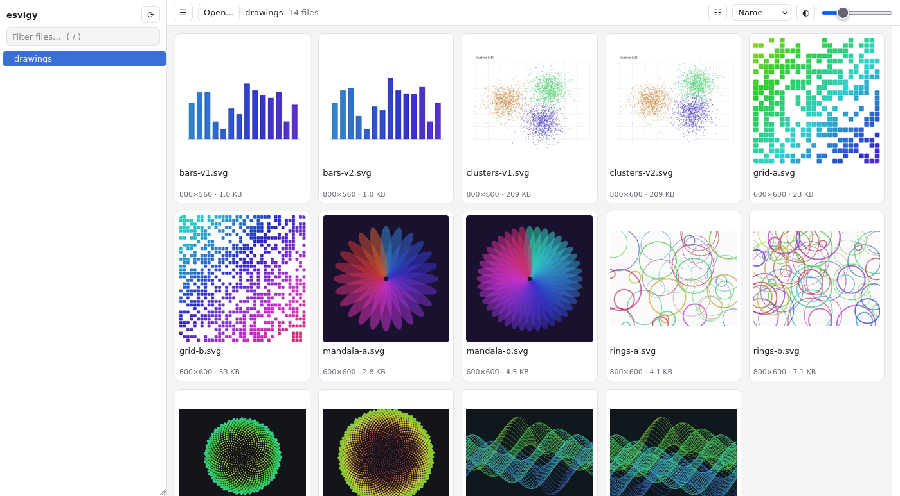
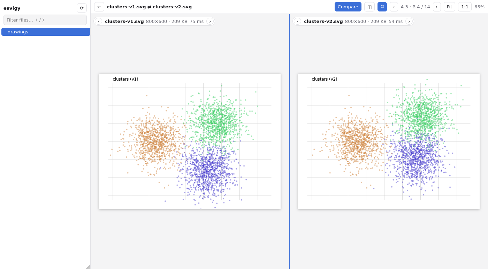

# esvigy

A fast SVG viewer for folders of (large) SVG files. It also shows PDFs, Illustrator files,
TIFFs and the common raster formats (PNG, JPEG, GIF, WebP, AVIF, BMP, ICO).

Classic image viewers (xviewer, eog, …) render SVG with librsvg, which gets very
slow on big files. Firefox's renderer is much faster, so esvigy uses Firefox as
its engine: a tiny local Python server (stdlib only) serves the folder, and the
UI runs in a Firefox window. Without Firefox, it uses Chrome, Chromium, Edge or Brave instead.

## Usage

    ./esvigy.py [DIR | FILE.svg]       # opens its own window: Firefox, else Chromium
    ./esvigy.py ~/drawings -b chromium # own window in Chrome/Chromium/Edge/Brave even if Firefox is there
    ./esvigy.py ~/drawings -b firefox  # normal Firefox window instead of the app window
    ./esvigy.py ~/drawings -b none    # just print the URL
    ./esvigy.py -h

Tip: `ln -s "$PWD/esvigy.py" ~/.local/bin/esvigy`

**Firefox is preferred, Chromium works too.** esvigy is tested with both (the browser tests
run in each). Firefox has the most even SVG speed (see the benchmark); Chromium is close on
most files, but up to about 2× slower on huge piles of small shapes. Chromium is found as Google
Chrome, Chromium, Microsoft Edge (part of Windows) or Brave. Other browsers (`-b default`) should
work, but are untested.

### macOS and Windows

esvigy is developed on Linux; macOS and Windows are supported but less tested. Python 3.9+
is all you need. Run it as `python3 esvigy.py` (macOS) or `py esvigy.py` (Windows). Firefox
and Chromium are found in their usual install locations (`/Applications`, `~/Applications`,
`Program Files`, `AppData\Local`) even when they aren't on `PATH`. On macOS, closing the window
doesn't quit the browser, so quit it with Cmd+Q (or press Ctrl+C in the terminal) to stop esvigy.

## Features

- Folder tree in the sidebar, thumbnail grid in the main panel
- Thumbnails are rendered once by the browser in a hidden frame (its own process, so the UI never freezes), two at a time, visible ones first,
  and cached in `~/.cache/esvigy/thumbs` (keyed on path + mtime + size), so a
  folder you've seen before opens instantly
- Viewer shows the cached thumbnail immediately, then swaps in the full render
- Pan (drag), zoom at cursor (wheel), double-click toggles fit / 100 %
- **Compare**: Ctrl-click (Cmd-click on macOS) two thumbnails and press *Compare* (or `c`), or press `c` in the viewer.
  Side by side or stacked (`l`), with pan/zoom linked between both (`y`). Each pane has its own ‹ › in its label; ←/→ step B,
  Shift+←/→ step A, and ↑/↓ or the top-bar ‹ › step both together. `c` goes back to a single file. The URL (`#file=a.svg&vs=b.svg`) is shareable.
- Table view (`t`): full file names, dimensions, size and date; click a column header to sort, click again to reverse
- File names get two lines in the grid (full name on hover)
- **PDF**: drawn by the bundled pdf.js (`static/vendor/pdfjs`, Mozilla, Apache-2.0),
  with thumbnails, zoom and compare like SVGs. Page size and page count show up once a PDF has
  been rendered (they are cached next to the thumbnail). PDF scripts never run in esvigy's viewer.
  Multi-page PDFs get a ‹ n / N › page bar; Page Up/Down turn pages (in compare mode on both
  sides; the page bars turn one side). The page is part of the URL (`&page=3`, `&vspage=2`).
  Illustrator files (`.ai`) are shown the same way: since CS they are PDFs inside.
- **Raster images**: PNG, JPEG, GIF, WebP, AVIF, BMP and ICO, decoded by Firefox itself (nothing
  bundled). Their size comes from the file header (JPEG rotation from EXIF included).
- **TIFF**: decoded by the bundled UTIF.js + pako (`static/vendor/utif`, MIT, about 80 KB) in a
  worker, so big scans don't freeze the UI. Multi-page TIFFs get the same page bar as PDFs.
- Each thumbnail carries a coloured badge with its file type (SVG, PDF, PNG, TIFF, …)
- Natural sort, filter, sort by size/date, `.svgz` support
- **Open…** (or `o`) picks another folder with the native dialog (zenity or kdialog on Linux; built in on macOS and Windows)
- Back button / Esc returns to the grid; URL hash keeps folder and file

## Keys

| Key | Grid | Viewer |
| --- | --- | --- |
| arrows | move between thumbnails | previous / next |
| Enter / Space | open | next (Space) |
| Esc / Backspace | | back to grid |
| f / 0, 1, + / - | | fit, 100 %, zoom |
| / | filter | |
| o / s / b / r | open folder / toggle sidebar / background / reload | same |

## Security

- Binds to 127.0.0.1 only and only serves files below the given directory
  (symlinks leading out of it are neither listed nor served).
- Every URL starts with a random secret (`http://127.0.0.1:PORT/<token>/`), new on each start.
  Other users on the machine and web pages that find the port get `403`. Treat the
  printed URL like a password; with `-b none`, don't paste it anywhere public.
- The secret never goes on the browser's command line, which other users can read (`ps`).
  The browser is started with the path of a private page (`~/.local/share/esvigy/open-*.html`,
  readable only by you) that forwards it to the secret URL; the page is deleted as soon as the
  browser has arrived.
- Requests that change something (Open…, thumbnail upload) also need an `X-Esvigy` header,
  which other websites can't send. Uploaded thumbnails must be WebP.
- SVGs are shown via ``, so scripts inside them never run; opened directly ("raw ↗")
  they get a CSP sandbox that blocks scripts and external loads. The UI forbids inline
  scripts and being framed by other sites.
- PDFs and AI files opened via "raw ↗" would be shown by the browser's own PDF viewer, which ignores
  the CSP. Only in Firefox's app window (the default with Firefox) is that viewer used, with PDF
  scripting switched off. Everywhere else (Chromium, `-b firefox`, `-b default`, `-b none`) "raw ↗"
  downloads them instead, since those viewers can't be told not to run scripts. esvigy's own viewer
  is not affected: it never runs PDF scripts.
- TIFFs are checked before the bundled UTIF.js decodes them (`static/tiffcheck.js`), because UTIF
  believes every size a file claims: looping or out-of-file directories, pages over 300 MP
  (about 1.2 GB decoded; A0 scanned at 600 dpi is more), oversized tiles or embedded JPEGs, and
  compressed data that expands beyond the image are refused with a message instead of
  freezing the browser or filling the memory.
- Programs esvigy starts (the browser, the folder dialog) are run by full path, found only in
  absolute `PATH` entries or their usual install locations, never in the current folder. On
  Windows only `.exe` files count, so a planted `firefox.bat` or `chrome.bat` next to your files can't run.
- Thumbnails (`~/.cache/esvigy/thumbs`) and the browser profiles are created `0700`. Thumbnails
  are kept forever; delete the folder to clear them.

## Own window

By default esvigy opens Firefox in a dedicated profile (`~/.local/share/esvigy/firefox-profile`)
with the tab bar, address bar and bookmarks hidden, window class `esvigy` (Linux), and quits
when you close the window. Your normal Firefox profile is untouched. Only one esvigy
window at a time can use that profile.

Without Firefox (or with `-b chromium`) the same kind of window opens in Chromium (`--app`), with
a fresh profile in the temp folder that is deleted when esvigy quits. Your normal Chrome profile is
untouched, and several esvigy windows can run at once.

## Benchmark

How long does a big SVG take to render at 1600×1200? librsvg is what xviewer, eog and most
file-manager thumbnailers use; it is called here the same way they do (GdkPixbuf). resvg is a newer,
standalone renderer (its command-line tool). Firefox is what esvigy uses; Chromium and WebKitGTK are
what esvigy would get as an Electron app or in a system webview (pywebview, Tauri on Linux). The browsers
draw the file into a canvas, as esvigy's thumbnail renderer does. All on the CPU, median of 3 runs,
fastest in bold.

| file | size | librsvg (eog, xviewer) | resvg | Firefox (esvigy) | Chromium | WebKitGTK |
| --- | ---: | ---: | ---: | ---: | ---: | ---: |
| filters-blur.svg (blur, mask, shadow) | 0.0 MB | 2.31 s | 1.57 s | **0.23 s** | 0.32 s | 3.37 s |
| paths-3000.svg (3000 polylines) | 2.7 MB | 0.89 s | 0.82 s | 0.32 s | 0.40 s | **0.17 s** |
| clipped-7000.svg (7000 clipped paths) | 5.3 MB | 2.27 s | 6.79 s | 1.29 s | 1.70 s | **1.02 s** |
| scatter-250k.svg (250 000 circles) | 18.7 MB | 3.20 s | **1.65 s** | 4.02 s | 5.60 s | 5.25 s |
| real matplotlib figure (shaded `pcolormesh`) | 6.9 MB | 36.89 s | **0.47 s** | 0.52 s | 0.93 s | 0.71 s |
| *slowest vs fastest* | | *78×* | *7×* | ***2.4×*** | *3.4×* | *15×* |

No engine is the fastest everywhere, but Firefox has the smallest worst case: it is never more than
2.4× behind the fastest engine on a file, and only on the plain pile of circles. Every other engine
has a file type where it falls far behind: librsvg on the matplotlib figure (half a minute), resvg on
filters and clipping, WebKitGTK on filters. The last row is a real 6.9 MB figure with about
3 600 gradients and 7 400 paths. It is private work data, so it isn't shared, and I could not reproduce
it with a generated file; treat it as one data point.

Where esvigy helps beyond the raw render time: the render happens in a separate Firefox process, so the
UI never freezes (WebKitGTK can't do this: it has no separate processes for frames), and thumbnails are
cached, so a folder you've seen before opens instantly.

Measured on an AMD Ryzen 5 5500U, Linux Mint 21.2, librsvg 2.52.5, resvg 0.48.1, Firefox 155.0.1,
Chromium 155 (Chrome for Testing), WebKitGTK 2.50.4; the browsers headless, WebKitGTK under Xvfb.
Reproduce with:

    python3 benchmark/gen.py heavy /tmp/heavy
    .venv/bin/python benchmark/bench.py /tmp/heavy [your.svg ...]   # folders and/or files

It needs the system python3 with PyGObject (librsvg, WebKitGTK), `resvg` on `PATH` (or `RESVG=/path/to/resvg`)
and xvfb-run for WebKitGTK; selenium downloads Chrome for Testing if Chrome is missing. Engines that
aren't available are skipped.

While it runs, the browsers load the files from a small server on 127.0.0.1 that serves only the
files being measured: no folder listing, no `index.html`, nothing else from their folders. So
benchmarking `~/work/fig.svg` doesn't expose the rest of `~/work`.

The screenshots above come from `.venv/bin/python docs/screenshots.py`.

## Tests

    python3 -m venv .venv && .venv/bin/pip install -r requirements-dev.txt
    .venv/bin/pytest                 # everything (~80 s with both browsers)
    .venv/bin/pytest -m "not e2e"    # no browser (~5 s)

- `tests/test_svg.py`: SVG size parsing and header rewriting
- `tests/test_server.py`: the HTTP server against a temp folder: listing, file serving,
  path-traversal/symlink/Host-header protection, thumbnail cache, the Open dialog (with a fake `zenity`)
- `tests/test_pdf.py`: PDFs on the server: listing, serving, and validating the page-size metadata the browser sends
- `tests/test_images.py`: raster images, TIFF and AI: sizes read from file headers (JPEG rotation included),
  listing, content types
- `tests/test_security.py`: one check per attack from the section above: missing/wrong token,
  cross-site writes, DNS rebinding, cache poisoning, malformed requests, escaping the root,
  security headers, file permissions, programs planted in the current folder, Windows network paths
- `tests/test_benchmark.py`: the benchmark's helper server serves only the measured files
  (also with spaces, `#` or `?` in their names) and refuses everything else
- `tests/test_e2e.py`: the UI in headless Firefox and headless Chromium via Selenium (grid, viewer,
  compare, table view, PDF and TIFF pages, raster images); `-k firefox` or `-k chromium` runs one.
  Also checks in a real browser that malicious SVGs and PDFs can't run scripts and that the CSP doesn't break the UI,
  and that hostile TIFFs (looping directories, false sizes, decompression bombs) are refused before decoding.
  Firefox gets the same preferences as esvigy's app profile.
  Each browser is skipped if it (or selenium) is missing; geckodriver/chromedriver are downloaded on first run.

Tests never touch your real thumbnail cache; it can also be redirected with `ESVIGY_CACHE=/some/dir`.
